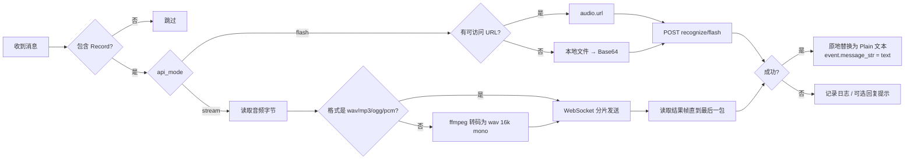

# astrbot_plugin_volc_asr

基于 **火山引擎（豆包）语音识别** 的 AstrBot 插件，支持两种接口模式：

- `flash`：录音文件极速版（一次 HTTP 请求，需资源 `volc.bigasr.auc_turbo` 授权）
- `stream`：流式语音识别（WebSocket，适合只开通了流式服务的账号）

收到语音消息后自动转写为文本，并把文本写回消息链，交由 LLM / 指令流程继续处理。

## 功能

- 多语种识别：中文、英语、日语、粤语等，留空语种则由服务端自动检测
- 无需公网：本地语音文件也可识别（flash 走 Base64，stream 走 WebSocket 分片上传）
- 双模式可切换：`api_mode=flash` 或 `api_mode=stream`，按账号实际开通的服务选择
- 支持引用消息、合并转发里的语音：递归查找并原地替换，保留 At 等其它组件
- 支持 `enable_itn`（数字规范化）、`enable_punc`（自动标点）、`enable_ddc`（语义顺滑）
- 连接复用 + 超时控制 + 网络错误重试；鉴权/参数错误不重试
- 识别失败可选择性回复提示，默认静默（不打断会话）

## 安装

1. 将本插件目录放入 AstrBot 的 `data/plugins/` 下
2. 安装依赖：`pip install -r requirements.txt`
3. **stream 模式**（QQ/微信语音多为 silk）：额外执行 `pip install pilk`
4. 重启 AstrBot，在 WebUI 的插件配置中填写 `api_key`

## 获取 API Key

火山引擎控制台 → 语音技术 → 录音文件识别（大模型）→ API Key 管理，创建一个 API Key。
v3 极速识别接口只需要 `X-Api-Key`，**不再需要** 旧版的 `app_id` / `access_token` / `cluster`
（配置面板中保留了这三个字段仅为兼容旧配置，填了也不会生效）。

## 配置项

| 字段 | 类型 | 默认值 | 说明 |
| --- | --- | --- | --- |
| `api_key` | string | 空 | **必填**，火山引擎 API Key |
| `api_mode` | string | `flash` | `flash`=极速版；`stream`=流式识别 |
| `resource_id` | string | `volc.bigasr.auc_turbo` | flash 模式资源 ID |
| `stream_resource_id` | string | `volc.seedasr.sauc.duration` | stream 模式资源 ID，并发版为 `volc.seedasr.sauc.concurrent` |
| `language` | string | 空 | 留空自动检测，如 `zh-CN`、`en-US`、`ja-JP`、`yue-CN` |
| `format` | string | 空 | 留空按后缀推断，可强制 `mp3`/`wav`/`pcm`/`ogg`/`silk`/`amr`/`aac`/`m4a`/`flac` |
| `ffmpeg_path` | string | `ffmpeg` | stream 模式下转码用的 ffmpeg（PATH 或绝对路径） |
| `stream_chunk_bytes` | int | `6400` | stream 模式分包大小，约 200ms 音频 |
| `enable_itn` | bool | `true` | 数字文本规范化 |
| `enable_punc` | bool | `true` | 自动加标点 |
| `enable_ddc` | bool | `false` | 语义顺滑 |
| `enable_auto_lang` | bool | `false` | stream 模式自动识别 25 种语种（需 `language` 留空，仅 nostream 支持） |
| `show_utterances` | bool | `false` | 返回分句结果（插件只取整段文本） |
| `timeout` | int | `30` | 单次请求超时（秒） |
| `max_retries` | int | `1` | 网络/超时错误重试次数（仅 flash 模式） |
| `max_audio_mb` | int | `10` | 本地语音文件大小上限（MB） |
| `reply_on_error` | bool | `false` | 识别失败时是否回复提示 |
| `error_reply` | string | `语音识别失败，请稍后重试。` | 失败提示文本 |
| `debug` | bool | `false` | 打印不含语音消息的组件结构，便于排查引用/转发 |
| `text_prefix` | string | `语音消息:` | 识别文本前缀，留空则不加；让大模型知道这是语音内容 |
| `user_uid` | string | `astrbot` | 透传给接口的 `user.uid` |
| `endpoint` | string | 官方地址 | flash 接口地址（高级） |
| `stream_endpoint` | string | 官方地址 | stream 接口地址（高级），默认单向流式 `bigmodel_nostream` |

## 目录结构

`main.py` 只保留插件类、事件入口与依赖装配，其余实现按职责放在 `volc_asr/` 包里。包内模块通过相对导入访问，不占用 `sys.path`，因此可以放心使用 `config.py`、`http.py` 这类短名。

```text
main.py                     插件入口：handle_voice、terminate
volc_asr/
├── __init__.py             包说明
├── config.py               配置解析（PluginConfig）
├── constants.py            端点 / 协议常量 / 格式表 / 错误码提示
├── errors.py               VolcASRError
├── http.py                 共享 aiohttp 会话
├── message.py              消息链查找、原地替换、写回 message_str
├── audio/
│   ├── source.py           音频来源、格式嗅探、本地路径、大小校验
│   └── transcode.py        PCM 重采样、WAV 封装、silk 解码、ffmpeg 转码
└── api/
    ├── protocol.py         流式二进制帧与响应体解析
    ├── flash.py            flash 模式识别器
    └── stream.py           stream 模式识别器
```

## 工作流程



识别结果会写入 `event.message_str`，因此后续的 LLM 请求可以直接看到文本内容；
插件不会调用 `stop_event()`，命令与 LLM 流程保持正常触发。

> 想了解它怎么处理语音、两种模式怎么选、出问题看哪里，见 [`docs/工作原理.md`](docs/工作原理.md)。

## 常见问题

**日志出现 `HTTP 403 ... code=45000030 requested resource not granted`**

说明 **API Key 没有被授予 `volc.bigasr.auc_turbo` 这个资源**。该资源不一定对所有账号开放，控制台里可能根本看不到「极速版」入口。处理方式：

1. **首选**：把 `api_mode` 改成 `stream`，使用你已开通的流式语音识别，配合 `stream_resource_id`（小时版 `volc.seedasr.sauc.duration` / 并发版 `volc.seedasr.sauc.concurrent`）
2. 若仍想用 flash：确认 API Key 所属项目与开通资源的项目一致
3. 注意 `volc.bigasr.auc`（模型 1.0）、`volc.seedasr.auc`（模型 2.0）属于**标准版**，走「提交任务 + 轮询结果」且**必须传公网可访问的 URL**，与 flash 不是同一个接口，改这个 ID 不会生效

**stream 模式报 `音频需要转码但找不到 ffmpeg` / `ffmpeg 无法解码 silk`**

流式接口只接受 `wav/mp3/ogg/pcm`，而 QQ/微信语音通常是 `silk`。插件会按文件头自动识别真实格式：

1. 识别为 `silk` → 用 `pilk` 解码为 16kHz PCM（需 `pip install pilk`）
2. 识别为 `amr`/`m4a`/`aac`/`flac` 等 → 用 ffmpeg 转码为 wav（需安装 ffmpeg 或配置 `ffmpeg_path`）
3. 两者都不可用时，日志会打印 `音频实际格式为 xxx（首字节 ...）`，据此判断该装哪个

`pilk` 需要与 Python 版本匹配的预编译包（Windows x64 提供 cp36–cp311 轮子）；若不匹配可改用 ffmpeg 方案先转成 mp3/wav。

**stream 模式报 `WebSocket 连接失败`**

检查是否能访问 `wss://openspeech.bytedance.com`（代理/防火墙），以及 `stream_resource_id` 是否与已开通的服务一致。

**语音没有任何反应**

1. 检查日志中是否有 `未配置 api_key`
2. 检查是否出现 `接口返回失败码`，`X-Api-Message` 会给出具体原因（常见为 Key 无效、资源未开通、并发超限）

**日志出现 `无法获取语音文件`**

平台的语音组件既没有可访问 URL，也拿不到本地文件路径。可尝试在配置中关闭平台侧的语音转码，或确认 AstrBot 版本支持 `Record.convert_to_file_path()`。

**识别到空文本**

静音、过短或纯噪声的语音会返回空结果，插件只记 `warning` 日志，不会修改原消息。

## 开发与测试

冒烟测试用 stub 的 `astrbot` 模块运行，不需要真实 AstrBot 环境：

```bash
python -m unittest discover -s tests -v
```
