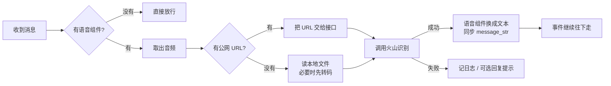

# 工作原理

一句话：**AstrBot 收到带语音的消息后，这个插件把语音送去火山引擎转成文字，再把文字放回消息里**，后面的 LLM / 指令流程就把它当普通文本处理。

插件自己不发言（除非开启失败提示），也不拦截事件。

## 1. 一条语音消息经历了什么

1. **找语音**：递归扫消息链（含引用消息、合并转发），找第一个 `Record`。找不到就直接返回，普通消息零开销。
2. **防重复**：在事件上打标记 `volc_stt_handled`，同一条事件只识别一次。
3. **取音频**：有 `Record.url` 就用 URL；没有就读本地文件（`convert_to_file_path()` / `file` / `path` / `file://`）。
4. **识别**：按 `api_mode` 调 flash 或 stream 接口，成功返回文本，失败抛错。
5. **写回**：把那个 `Record` 原地换成 `Plain("语音消息:…")`，并同步 `event.message_str`，其它组件（`At`、引用结构）保持不动。

全程不调用 `stop_event()`，所以后面的指令和 LLM 流程照常触发。

## 2. flash 还是 stream

| | flash（默认） | stream |
| --- | --- | --- |
| 接口 | HTTP 一次请求 | WebSocket 流式 |
| 资源 ID | `volc.bigasr.auc_turbo` | `volc.seedasr.sauc.duration`（小时版）/ `…concurrent`（并发版） |
| 需要的授权 | 极速版（不一定对每个账号开放） | 流式语音识别（已开通即可） |
| 音频怎么发 | 公网 URL，或本地文件转 Base64 | 分片发送，支持本地文件 |
| 支持格式 | 服务端不接受时插件会先转 wav | 仅 `pcm / wav / ogg / mp3` |
| 语种参数 | 支持 `language` | 只有 `bigmodel_nostream` 端点支持 `language` / 自动语种 |

**怎么选**：先用默认的 flash；如果日志报 `45000030`（资源未授权），把 `api_mode` 改成 `stream`。

## 3. 音频格式怎么处理

| 情况 | 处理方式 |
| --- | --- |
| 有公网 URL | flash 直接把 URL 交给接口（`audio.url`） |
| 本地文件、常见格式 | flash 读字节转 Base64（`audio.data`）；stream 直接分片发 |
| `silk`（QQ/微信语音） | flash：用 `pilk` 解码成 PCM 再封成 wav；stream：解码后按 `pcm` 发 |
| `amr / aac / m4a / flac` | 用 ffmpeg 管道转成 16 kHz 单声道 wav |

格式判断靠**文件头嗅探**，不依赖扩展名——平台下载的语音经常没有正确后缀。

## 4. 识别结果怎么写回消息

- 只替换那个 `Record`，`At`、引用结构等其它组件保持原样；只有找不到原组件时才整链替换。
- `event.message_str` 与 `event.message_obj.message_str` 都同步，因为下游的指令匹配 / LLM 组装读的是字符串。
- 文本前缀由 `text_prefix` 控制（默认 `语音消息:`），提醒模型这段内容来自语音。
- 事件上额外记录两个键：`volc_stt_text`（不带前缀的原始文本，供其它插件用）、`volc_stt_handled`（防重复）。

## 5. 出问题看哪里

| 日志 | 原因 | 处理 |
| --- | --- | --- |
| `未配置 api_key` | 没填密钥 | 配置面板填写 |
| `code=45000030 requested resource not granted` | 这个 Key 没有极速版资源 | `api_mode` 改成 `stream` |
| `HTTP 4xx/5xx` | 网关或地址错误 | 检查网络、代理、`endpoint` |
| `WebSocket 连接失败` | wss 连不上 | 检查代理、`stream_resource_id` |
| `未识别到有效文本` | 静音 / 太短 / 纯噪声 | 正常现象，不改原消息 |
| `音频需要转码但找不到 ffmpeg` | 格式不支持且没有 ffmpeg | 安装 ffmpeg 或配置 `ffmpeg_path` |
| `未安装 silk 解码库` | 缺 pilk | `pip install pilk` |
| `无法获取语音文件` | 既没 URL 也拿不到本地路径 | 确认平台适配器是否提供 `Record` 路径 |

配置项全表、安装步骤和更多常见问题见 [README](../README.md)。

## 6. 已知限制

1. **只适合短语音**：用的是极速版 / 单向流式接口，长音频（会议录音）应改用标准版「提交 + 轮询」。
2. **依赖平台给出音频**：某些适配器只给引用 id 不给组件链时拿不到语音，可开 `debug` 看消息结构日志。
3. **Base64 会膨胀**：约 1.33 倍，所以本地文件有 `max_audio_mb` 上限；能拿到 URL 时优先走 URL。
4. **不缓存、不限流**：同一条语音重复发会重复计费，并发由火山侧配额约束。

想改代码，先看 README 的「目录结构」。
